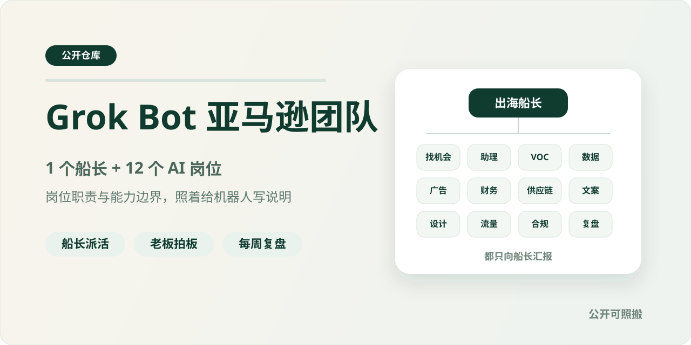
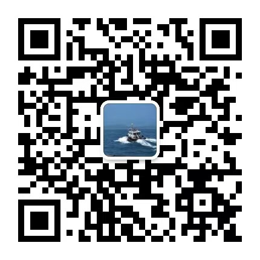

# Grok Bot 亚马逊团队：1 个船长 + 12 个 AI 岗位

> **作者**：[Zach](https://github.com/zach22-1999) ｜ 公众号「Zach的进化笔记」
>
> Learn in public！我在 Grok Bot 上搭的亚马逊 AI 团队，岗位怎么分、边界怎么写，全部公开。



---

## 这个仓库是什么

这里公开的是我这支亚马逊 AI 团队「1 个船长 + 12 个业务岗位」的完整岗位职责和能力边界。

这个仓库只公开岗位怎么分、边界怎么写，不含背后的 Skill 和代码。每个角色都按同一个格式写：定位、职责、不做什么、交给谁、什么时候停下来问人。你可以照着它，在 Grok Bot 里给自己的机器人写说明。

怎么从 0 到 1 搭起来、为什么这样分，写在两篇公众号文章里：

- [用 Grok Bot 做跨境电商的实战分享 - 从 0 到 1 搭建起一整个亚马逊团队](https://mp.weixin.qq.com/s/kurhMnQX-ikRN1uoNMtiMg)
- [从一个 Bot 到一整个组织，Grok Bot 的进阶用法分享：本地电脑、AI 分工和知识库怎么接起来？](https://mp.weixin.qq.com/s/sx9YiODP-YbQDVdHE9UltA)

## 当前状态

**Status: Ready to Push**

v1.0（2026-10-19），和公众号回复「Grok Bot组织架构」领到的附件是同一版内容。

---

## 推荐安装方式：让 AI 帮你装

刚起步，建议先按「单个/相似任务＝一个机器人」跑通，用顺了、真有交接的需要了，再整支搭起来。

**已经在用 Grok Bot**，把这段话发给你平时对话的那个机器人：

```text
读一下 https://github.com/zach22-1999/grok-bot-amazon-team 这个仓库，照着它帮我新建一支「1 个船长 + 12 个岗位」的团队，一共 13 个机器人：先新建「出海船长」，以后我只跟它说话，它的说明用 roles/00-captain.md，再加上 README 里的「四条链加一个回路」；12 个岗位按 roles/ 里对应的岗位说明建；每个机器人的说明末尾都贴上 common-rules.md。我的业务是＿＿＿，用不上的岗位先标出来，和要建的机器人清单一起发我确认，确认后再动手。
```

**还没开始用 Grok Bot，或者想先改成自己的版本**，在 Claude Code、Codex、Cursor 里说：

```text
帮我读一下 https://github.com/zach22-1999/grok-bot-amazon-team 这个仓库，把 13 个机器人的说明整理成可以直接贴进 Grok Bot 的版本：每个机器人一份，岗位说明在前，全员通用规则在后；出海船长那份再加上四条链和周复盘回路。我的业务是＿＿＿，用不上的岗位先标出来问我；删掉或改名的岗位，其他说明、四条链和通用规则里提到它的地方一起改掉。
```

建出来的机器人只有岗位说明，还没有 Skill：按[手动搭建说明](./docs/manual-install.md)第 2 步，把已经跑通的 Skill 分进对应岗位，从一条最常用的链开始跑。

> ⚠️ **使用提醒**：岗位 2「跨境狠人们的助理」要登录买家账号，按买家视角巡检前台。别让它高频地「当人」：我的定时任务基本一天一次，没变化就不报；买家账号只看，不下单、不加购、不留评、不提问，免得被亚马逊的反爬机制盯上、丢掉这个买家号。真需要高频取数，尽量用合规、付费的 API 或 MCP 接口。自动浏览是否符合亚马逊的使用条款，请自行判断，风险自担。

---

## 组织图

一共 13 个机器人：1 个船长 + 12 个岗位。

| 编号 | 角色 | 分工 | 岗位说明 |
|---|---|---|---|
| 船长 | 出海船长 | 入口与调度 | [00-captain.md](roles/00-captain.md) |
| 岗位 1 | 上架前找机会的海盗 | 向外看，上架前 | [01-opportunity-scout.md](roles/01-opportunity-scout.md) |
| 岗位 2 | 跨境狠人们的助理 | 日常巡检，只发现异常、保留证据 | [02-assistant.md](roles/02-assistant.md) |
| 岗位 3 | 上架后做VOC的老大 | 向内看用户，上架后 | [03-voc.md](roles/03-voc.md) |
| 岗位 4 | 运营数据分析大佬 | 向内看数据 | [04-ops-analyst.md](roles/04-ops-analyst.md) |
| 岗位 5 | 合理烧钱的广告投手 | 站内广告 | [05-ads.md](roles/05-ads.md) |
| 岗位 6 | 盯财务的眼睛 | 经营支撑 | [06-finance.md](roles/06-finance.md) |
| 岗位 7 | 搞供应链的大师 | 经营支撑 | [07-supply-chain.md](roles/07-supply-chain.md) |
| 岗位 8 | 懂用户的文案高手 | 内容生产 | [08-copywriter.md](roles/08-copywriter.md) |
| 岗位 9 | 有品味的设计偏执狂 | 内容生产 | [09-designer.md](roles/09-designer.md) |
| 岗位 10 | 懂全域流量的大佬 | 跨渠道流量 | [10-traffic.md](roles/10-traffic.md) |
| 岗位 11 | 管合规的守门员 | 把关 | [11-compliance.md](roles/11-compliance.md) |
| 岗位 12 | 抓运营复盘的机器人 | 复盘 | [12-retro.md](roles/12-retro.md) |
| 全员 | 全员通用规则 | 每个机器人都要遵守 | [common-rules.md](common-rules.md) |

> 📌 **汇报链：所有角色都只向出海船长汇报；凡是要问老板、交老板的，一律发给出海船长转达。**

## 设计原则

1. 先搭框架，再往岗位里放工作流，后面慢慢优化。
2. 按功能分岗位，不照搬传统公司「一个运营干所有活」的分法。
3. 重要、能沉淀经验的活单独设岗：财务从数据分析里拆了出来，广告从数据分析和流量策略里拆了出来。
4. 基础、高频、按 SOP 走的活，交给一个通用助理：它只发现异常、保留证据，分析交给专门的角色。
5. Skill 不是一个配一个机器人：一个岗位可以用好几个 Skill，同一个 Skill 也可以被不同岗位借用。
6. 只有一个入口：老板只跟出海船长说话，其他角色都向它汇报。
7. 凡是会动卖家后台、广告后台的事，AI 只出「待批清单」，由老板逐条批准或自己执行。

## 四条链加一个回路

### 日常巡检链

1. 跨境狠人们的助理每天巡检前台、自家 Listing 和竞品。
2. 发现变化和异常，保留证据，交出海船长；严重异常立刻报，不等日报。
3. 出海船长按问题分给运营数据分析大佬、合理烧钱的广告投手或懂全域流量的大佬去分析。

### 选品链

1. 出海船长派单。
2. 上架前找机会的海盗出机会报告。
3. 盯财务的眼睛做单品利润测算。
4. 出海船长收敛成立项建议书，老板拍板是否立项。

### 上新链

1. 出海船长派单。
2. 懂用户的文案高手出 Listing 草稿。
3. 有品味的设计偏执狂出视觉方案和候选图。
4. 管合规的守门员判定。
5. 出海船长做上架终检，老板批准后自己上线。

### 诊断链

1. 出海船长派单。
2. 运营数据分析大佬做诊断。
3. 按问题分流给合理烧钱的广告投手、盯财务的眼睛或搞供应链的大师。
4. 出海船长汇总待批清单，老板逐条批准。

### 周复盘回路

1. 各角色每周交产出和成败经验。
2. 抓运营复盘的机器人写周报、更新经验库。
3. 出海船长据此排下周计划，判断要不要改 Skill 或流程。
4. 回到各角色执行。

> 💡 **一句话记住：船长派活，各岗位只交草稿和建议，守门员把关，老板拍板，复盘机器人每周把经验收回来。**

---

## 仓库边界

这个仓库只公开：

- 岗位怎么分、每个岗位的职责和能力边界
- 岗位之间的交接链和每周复盘回路
- 全员通用规则和照着搭的步骤

这个仓库不包含：

- 岗位背后的 Skill 和代码
- 任何真实店铺数据、账号和密钥

本仓库是个人实践分享，与 xAI、Grok 官方无关。

---

## 关于作者

关注「**Zach的进化笔记**」，获取 AI x 跨境电商的实战经验、工具和方法论，
也会分享对应跨境电商和 AI 相关的一些思考：



加我微信，备注「进群」，拉你进免费交流群「Zach的朋友们」，一起交流 AI + 跨境电商的实战玩法：


长文也会同步发到 X：[@1999Zach22](https://x.com/1999Zach22)。

---

## License

© 2026 Zach（公众号「Zach的进化笔记」）。本仓库内容采用 [CC BY 4.0](./LICENSE) 许可：可以免费使用、修改和商用。转载或改编时，请注明来源（Zach｜公众号「Zach的进化笔记」），附上本仓库链接，并注明采用 CC BY 4.0 许可（https://creativecommons.org/licenses/by/4.0/）；改过的地方请写明。
